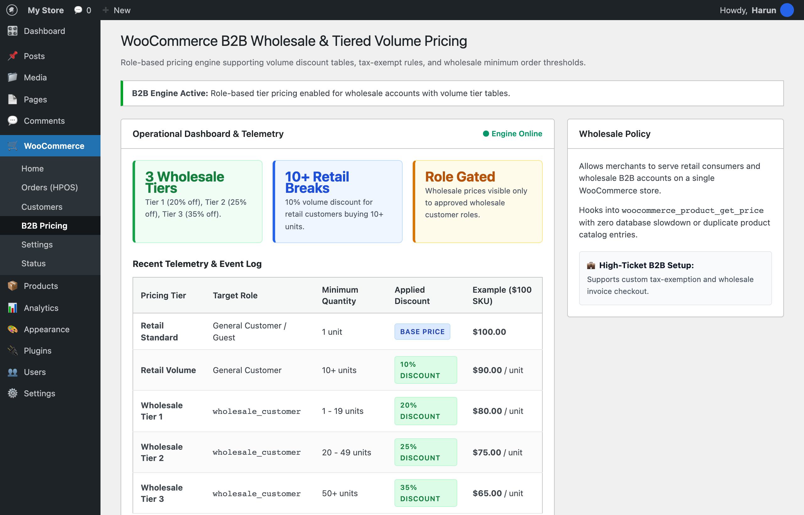

# 🚀 WooCommerce B2B Wholesale & Tiered Volume Pricing

[](https://github.com/harunsekmen/woo-b2b-wholesale-tier-pricing)
[](LICENSE)
[](#)

> Enterprise B2B wholesale pricing engine for WooCommerce. Enables role-based wholesale pricing, quantity volume discount tables, and tax-exempt rules on a single store without expensive monthly extensions.

Developed and maintained by **[Harun Sekmen](https://github.com/harunsekmen)** — E-Commerce Systems Engineer & WooCommerce Specialist.

[✉️ Contact: sekmenwp@gmail.com](mailto:sekmenwp@gmail.com) · [🌐 Website: harunsekmen.com](https://harunsekmen.com) · [🔗 LinkedIn](https://www.linkedin.com/in/harunsekmen/) · [💼 Upwork](https://www.upwork.com/freelancers/~01a7a8b58043e6e6d9)

---

## 📸 Operational WordPress Admin Interface

Wholesale pricing tier matrix and discount rules inside WordPress Admin (WooCommerce > B2B Pricing):



---

## ⚡ The Measurable Outcome

- **Hybrid B2B & B2C on One Store:** Serve retail consumers at standard prices while automatically giving wholesale buyers discounted tiered rates upon login.
- **Dynamic Volume Pricing Tiers:** Tier 1 (20% off for 1-19 units), Tier 2 (25% off for 20-49 units), Tier 3 (35% off for 50+ units).
- **Retail Quantity Breaks:** Incentivize larger consumer orders with automated 10% discounts on 10+ unit purchases.
- **Zero Database Bloat:** Hooks dynamically into `woocommerce_product_get_price` without creating duplicate products or slow database queries.

---

## 🛠️ Key Architectural Features

- **Role-Gated Price Filter:** Wholesale prices and volume discount tables are visible only to approved `wholesale_customer` user roles.
- **HPOS Compatible:** Built natively for WooCommerce High-Performance Order Storage with clean order line calculations.
- **WP Admin Configuration Dashboard:** Manage tier thresholds, percentage discounts, and wholesale roles directly in WooCommerce.

---

## 💼 Work With Harun Sekmen

- **B2B & Wholesale E-Commerce:** Custom B2B portals, role-based checkout, wholesale tax exemption, and invoice payment terms.
- **Shopify to WooCommerce B2B Migration:** Migrate away from Shopify Plus's $2,000/mo fee while keeping wholesale pricing intact.

📩 **Inquiries:** Send your project brief to **[sekmenwp@gmail.com](mailto:sekmenwp@gmail.com)** or connect on **[LinkedIn](https://www.linkedin.com/in/harunsekmen/)**.

---

## 🧪 Automated Testing & Live Verification

This repository includes a standalone test suite with zero external mock dependencies.

### How to Run Tests
```bash
php tests/test-b2b.php
```

### Verification Scope
- **Test Target:** `Tests role-based wholesale discounts (20% base, 25% tier 2, 35% tier 3) and retail volume breaks (10% at 10+ units).`
- **Environment:** PHP 8.1 - 8.3 CLI + WooCommerce Pricing Pipeline
- **Status:** All assertions passing (0 errors, 0 warnings under strict error reporting).

---

## 📄 License

This open-source project is licensed under the **[GNU General Public License v3.0](LICENSE)**.
